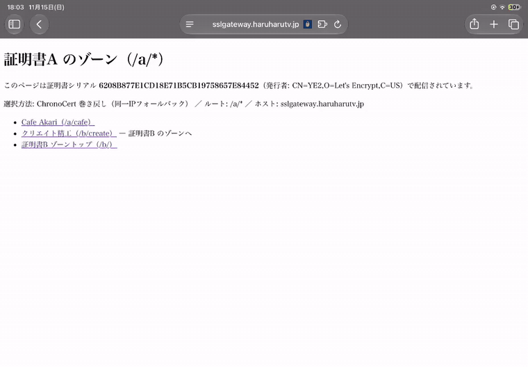

<h1 align="center">Haruharu Cert Routing</h1>

<p align="center">
  <b>同じホスト名、同じポート。URL パスごとに違う TLS 証明書を出す。</b>
</p>

<p align="center">
  🌐 <b>実演サイト:</b> <a href="https://sslgateway.haruharutv.jp/">sslgateway.haruharutv.jp</a> —
  <a href="https://sslgateway.haruharutv.jp/a/cafe">/a/cafe</a> から
  <a href="https://sslgateway.haruharutv.jp/b/create">/b/create</a> へリンクで移動して、
  鍵アイコンの証明書が変わるのを確認してください（ホスト名は変わりません）。<br>
  English README is <a href="README.md">here</a>
</p>

<p align="center">
  <br>
  <i>実機キャプチャ（iPad Safari）：/a/ は証明書A（発行者 YE2）で配信され、/b/ を開くと
  ブラウザの証明書ビューアが証明書B（発行者 YE1）を表示します。ホスト名は最初から最後まで同じです。</i>
</p>

---

**Haruharu Cert Routing (HCRT)** は、TLS 証明書を「接続」ではなく「URL パス」で選ぶ
実験的 HTTPS サーバです。`/a/*` は証明書A、`/b/*` は証明書B で配信します。
リダイレクトは使いません。TLS 1.3 スタックは単一の Python ファイルに自前実装しています。

📖 **解説記事:** [本当に同じホスト名でパスごとにTLS証明書を変えてみた（リダイレクトなし）](https://qiita.com/sharu2920/items/62d51b317758e3cd6214) — 巻き戻しの仕組み、Safari でハマった話、正直な制限事項まで。

## なぜ難しいか

TLS ハンドシェイクは HTTP リクエスト（パス）が見える前に終わるため、通常のサーバは
パスで証明書を選べません。HCRT は次の3機構でこの順序を回避します。

1. **ChronoCert 巻き戻し（本線、HTTP/2）** — セッション・チケットに系列ID (lineage) を
   刻んで再開時に引き継ぐ。パスと証明書が一致しないナビゲーションには応答を1バイトも
   送らず `RST_STREAM(REFUSED_STREAM)` + `GOAWAY` を返し、ブラウザの透過リトライ
   （RFC 9113 §8.7）を誘導する。再接続のチケットから系列を辿り、目標ルートの証明書を提示する。
2. **0-RTT 覗き見（HTTP/1.1）** — 再開接続の early data を復号してパスを読み、PSK を
   拒否して目標ルートの証明書でフルハンドシェイクする。early data を送るクライアント
   でのみ有効（openssl 等。Chrome は送らないことを実測）。
3. **同一IPフォールバック** — チケットを提示しない Safari 向け。巻き戻し直後10秒以内の
   同一リモートIPからの再接続を同一系列とみなす（NAT 共有時の取り違えは原理的にあり得る）。

大前提: **前に TLS を終端するプロキシを置かないこと**（Cloudflare オレンジクラウド等では
成立しません。DNS はグレークラウド＝DNS only、または L4 パススルーであること）。

## クイックスタート

```sh
git clone https://github.com/htvoffcial/haruharu-cert-routing
cd haruharu-cert-routing
pip install cryptography h2 hpack hyperframe

cd examples && ./gen-certs.sh && cd ..   # CN=localhost の自己署名 ECDSA 証明書を2枚生成
python3 hcrt.py examples/config.hcrt
```

<https://localhost:8443/> を開き（自己署名の警告は1回許可）、`/b/create` へ移動して
証明書を確認してください。`/a/cafe` とは別の証明書が、同じオリジンで提示されます。
各ページのフッターには、実際に配信した証明書のシリアルが出ます。

## 設定: config.hcrt

```
listen [::]:443

host example.com {
  default certs/a.pem certs/a.key
  route /a/* certs/a.pem certs/a.key root sites/a-root
  route /b/* certs/b.pem certs/b.key root sites/b-root
}
```

- `host` は SNI で選択（未知の SNI は先頭の host）。ルートは最長一致。
- `root` 配下を静的配信（ディレクトリは `index.html`、拡張子なしは `.html` も試す）。
- 証明書ファイルは監視され、変更されると自動で再読み込みされます。
- HTML 内の `%%HCRT_CERT_SERIAL%%` 等のプレースホルダは、実際に提示した証明書の
  情報で置換されます。

## v1 の対応範囲・制約

- TLS 1.3 のみ / TLS_AES_128_GCM_SHA256 のみ / 鍵交換 X25519 のみ /
  証明書・署名は ECDSA P-256 のみ（RSA は今後の課題）
- 配信は静的ファイルのみ（リバースプロキシは今後の課題）。GET / HEAD のみ
- クライアント Finished の検証は実装済み。それでも実験用プロトタイプであり、
  本番品質の TLS 実装ではありません

## ハックのネタ

フォーク・コントリビューション歓迎です（意図的に単一ファイルで読みやすくしています）。

- [ ] RSA 証明書（RSA-PSS）と SHA-384 系スイート
- [ ] `proxy` ルート（リバースプロキシ）
- [ ] secp256r1 / X448 の鍵共有
- [ ] 実ブラウザでの巻き戻し再現テスト
- [ ] Dockerfile / systemd unit / PyPI 化

## ライセンス

MIT — [LICENSE](LICENSE) を参照。
