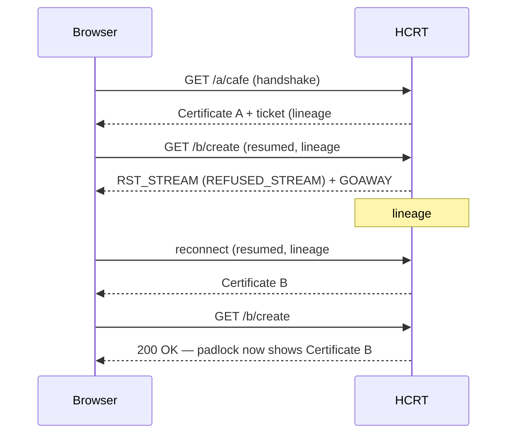

<h1 align="center">Haruharu Cert Routing</h1>

<p align="center">
  <b>One hostname. One port. A different TLS certificate for every URL path.</b>
</p>

<p align="center">
  
  
  
  
</p>

<p align="center">
  🌐 <b>Live demo:</b> <a href="https://sslgateway.haruharutv.jp/">sslgateway.haruharutv.jp</a> —
  open <a href="https://sslgateway.haruharutv.jp/a/cafe">/a/cafe</a>, click through to
  <a href="https://sslgateway.haruharutv.jp/b/create">/b/create</a>, and check the padlock:
  the certificate changed, the hostname didn't.<br>
  日本語版 README は <a href="README.ja.md">こちら</a>
</p>

---

**Haruharu Cert Routing (HCRT)** is an experimental HTTPS server that selects the TLS
certificate **by URL path** instead of by connection. `/a/*` is served with Certificate A,
`/b/*` with Certificate B — same hostname, same port, no redirects. The TLS 1.3 stack is
implemented from scratch in a single Python file, just to prove it can be done natively.

```hcrt
listen [::]:443

host example.com {
  default certs/a.pem certs/a.key
  route /a/* certs/a.pem certs/a.key root sites/a-root
  route /b/* certs/b.pem certs/b.key root sites/b-root
}
```

## Why is this hard?

A TLS handshake finishes **before** the server ever sees the HTTP request, so a normal
server cannot know the path when it must choose a certificate. SNI selects by hostname —
nobody selects by path. HCRT cheats the ordering with three mechanisms:

| Mechanism | Transport | How it works |
|---|---|---|
| **ChronoCert rewind** (main) | HTTP/2 | Session tickets carry a *lineage ID*. When a navigation targets a route whose certificate differs from the one already presented, the server answers with `RST_STREAM (REFUSED_STREAM)` + `GOAWAY` — without sending a single response byte — so the browser transparently retries on a fresh connection (RFC 9113 §8.7). The remembered lineage tells the server which certificate the retry actually wants. |
| **0-RTT peek** | HTTP/1.1 | On a resumed connection, the server decrypts the early data, reads the path (`GET /b/...`), refuses the PSK, and runs a full handshake presenting the target route's certificate. Works with clients that actually send early data on navigations (openssl does; Chrome, measurably, does not). |
| **Same-IP fallback** | any | Safari presents no ticket at all, so for 10 seconds after a rewind, a reconnection from the same remote IP is treated as the same lineage. (NAT collisions are theoretically possible — accepted for an experiment.) |

Hard requirement: **no TLS-terminating proxy in front.** Behind Cloudflare's orange cloud
(or any L7 CDN) the client only ever sees the edge certificate and none of this works.
Use DNS-only ("grey cloud") or an L4 pass-through.



## Quick start

```sh
git clone https://github.com/htvoffcial/haruharu-cert-routing
cd haruharu-cert-routing
pip install cryptography h2 hpack hyperframe

cd examples && ./gen-certs.sh && cd ..   # two self-signed ECDSA certs, same CN=localhost
python3 hcrt.py examples/config.hcrt
```

Open <https://localhost:8443/> (accept the self-signed warning once), then click through
to `/b/create` and inspect the certificate in your browser — it is a *different* certificate
from the one on `/a/cafe`, on the same origin. Each page footer prints the serial number of
the certificate that actually served it.

## Configuration: `config.hcrt`

```
listen [::]:443                      # or 0.0.0.0:443, or just a port

host sslgateway.haruharutv.jp {      # selected by SNI; unknown SNI → first host
  default certs/a.pem certs/a.key    # certificate for connections outside any route
  route /a/* certs/a.pem certs/a.key root sites/a-root
  route /b/* certs/b.pem certs/b.key root sites/b-root
  route /*   certs/a.pem certs/a.key root sites/top-root
}
```

- Routes match by longest path prefix. `root` is served statically
  (directories resolve to `index.html`; an extensionless path also tries `.html`).
- Paths are relative to the config file. Certificate files are watched and
  **hot-reloaded** when they change (Let's Encrypt renewals just work).
- HTML placeholders are replaced with the certificate that *actually* served the page:
  `%%HCRT_CERT_SERIAL%%`, `%%HCRT_CERT_ISSUER%%`, `%%HCRT_CERT_SUBJECT%%`,
  `%%HCRT_CERT_FINGERPRINT%%`, `%%HCRT_HOW%%` (how the cert was chosen),
  `%%HCRT_ROUTE%%`, `%%HCRT_HOST%%`.

## Scope & honest limitations (v1)

- TLS 1.3 only; one cipher suite (`TLS_AES_128_GCM_SHA256`); key exchange X25519 only;
  certificates and signatures **ECDSA P-256 only** (no RSA yet).
- Static file serving only (no reverse proxy yet). GET / HEAD only.
- Client Finished verification *is* implemented; this is still an experimental
  from-scratch TLS stack — **not** production-hardened. Run the live demo, not your bank.

## Ideas to hack on

Contributions and forks are very welcome — this project is deliberately a single,
readable file. Good entry points:

- [ ] RSA certificates (RSA-PSS CertificateVerify) and the SHA-384 cipher suites
- [ ] `proxy` routes (reverse-proxy to an upstream instead of a static root)
- [ ] secp256r1 / X448 key shares
- [ ] A test suite that replays the rewind dance against real browser engines
- [ ] Packaging: Dockerfile, systemd unit, PyPI

See [CONTRIBUTING.md](CONTRIBUTING.md).

## Story

HCRT started as an argument: *"a path can never choose a certificate natively."*
One day, two Let's Encrypt certificates, one hand-written ACME client and a from-scratch
TLS 1.3 implementation later, it runs live at
[sslgateway.haruharutv.jp](https://sslgateway.haruharutv.jp/). The rewind design
("ChronoCert") was refined from a hand-off spec written during a multi-AI design session.

## License

MIT — see [LICENSE](LICENSE).
